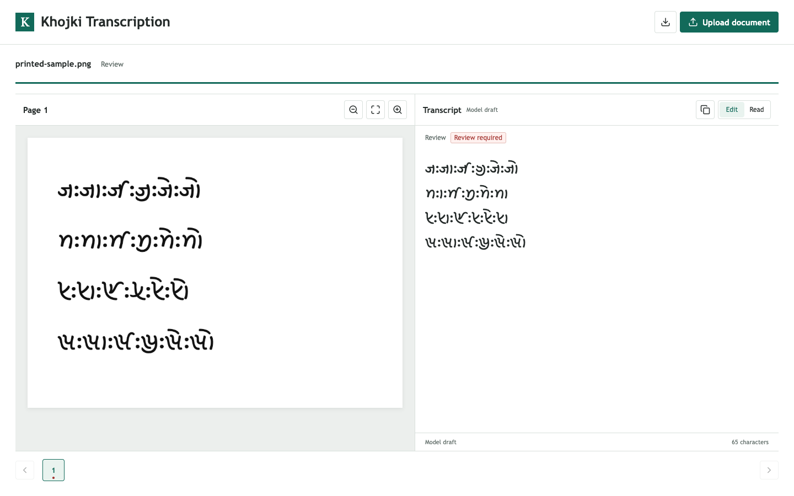

# Khojki OCR pipeline

Local OCR for Khojki script, with line detection, an editable transcript and UTF-8 download.



## Setup

Prerequisite: [Conda](https://docs.conda.io/projects/conda/en/latest/user-guide/install/index.html). This setup was tested on Intel macOS. The clone includes the trained model and its configuration; no separate model download or file arrangement is needed.

```sh
git clone https://github.com/aruhant/khojki-ocr.git
cd khojki-ocr
conda env create -f environment.yml
conda activate khojki-ocr
python -m pip install -e '.[ocr]'
python -m pip install --force-reinstall --no-deps --only-binary=:all: Pillow==13.0.0
python -m pip check
```

## Use the App

After setup, run:

```sh
python -m khojki_ocr.server
```

Open [http://127.0.0.1:8765](http://127.0.0.1:8765), upload a PDF, PNG or JPEG, and edit the recognized text beside the source image. Use the download button to save UTF-8 text. Uploads are processed locally; the default limit is 20 MB and 20 pages.

To try the example shown above, upload [web/assets/printed-sample.png](web/assets/printed-sample.png).

In a new terminal session, run `conda activate khojki-ocr` before starting the app again.

## Command Line

After setup, replace `scan.pdf` with your input file:

```sh
python -m khojki_ocr.pipeline --input scan.pdf --output runs/page \
  --model models/khojki-printed.safetensors --dpi 180 \
  --disable-references --export-drafts
```

Text files are saved in `runs/page/drafts`; `runs/page/report.json` contains detected lines and processing errors. If a line fails, processing continues and the command exits with code 1. Check the report for missing text.

## Results

Character error rate (CER) measures substitutions, insertions and deletions against the reference text; lower is better.

| Input | Evaluated Sample | CER |
| --- | --- | --- |
| Raw PDF pages, cold run | Five annotated lines, 103 code points | 20.39% |
| Manual crops of those lines | Five lines, 103 code points | 20.39% |
| Separate short-word test | Five words, 20 code points | 20.00% |
| Generated screenshot sample, cold run | Four lines, 67 code points | 7.46% |

See [results/cold-run-validation.json](results/cold-run-validation.json) for the current pipeline checks, [results/final-model-summary.json](results/final-model-summary.json) for model training, [REPRODUCING.md](REPRODUCING.md) to rerun evaluations, and [RETRO.md](RETRO.md) for experiments and error analysis.

## Attribution

The recognizer is adapted from Kraken PP-OCRv6 small. Model, font and icon licenses are in [THIRD_PARTY_NOTICES.md](THIRD_PARTY_NOTICES.md).